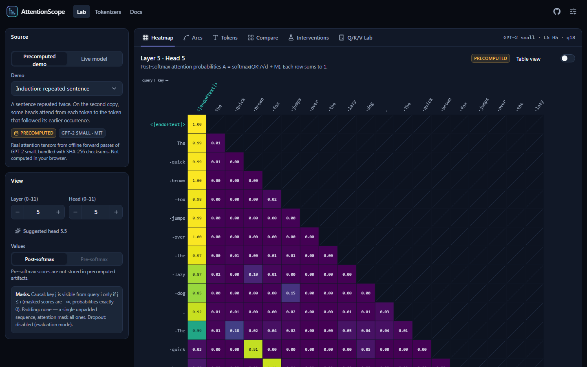
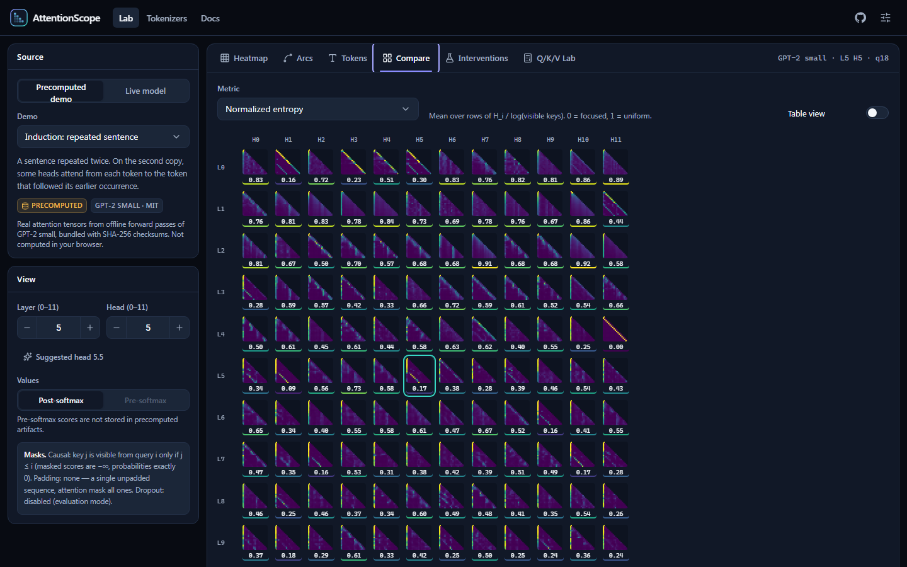
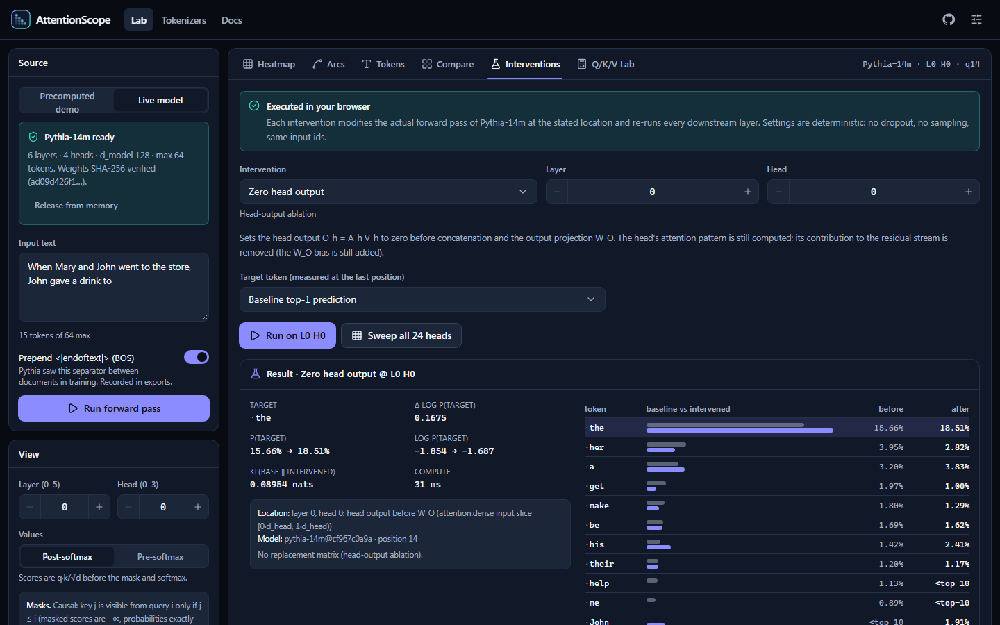
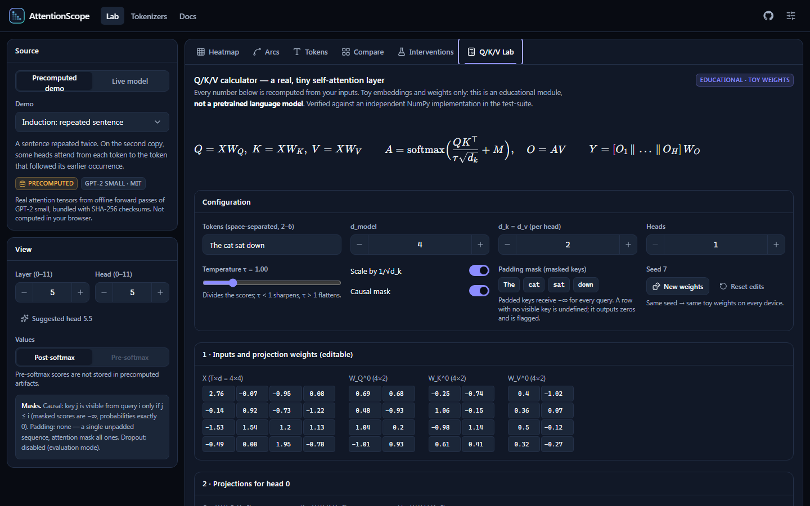
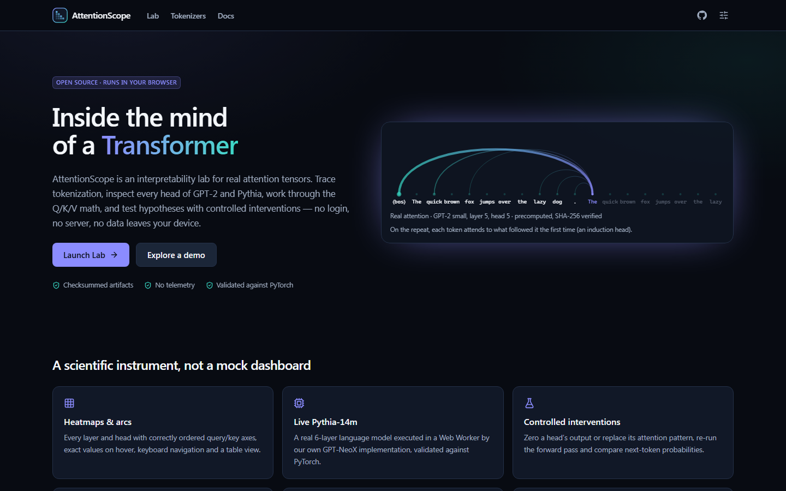

# AttentionScope

**Inside the Mind of a Transformer** — an open-source interpretability lab that runs entirely in your browser.

**Live:** https://aashikshahriar.github.io/attentionscope/

Inspect real attention tensors from GPT-2 and Pythia, trace tokenization byte by byte, work through the Q/K/V
arithmetic on a live toy layer, compare all heads with quantitative metrics, and run controlled head ablations
and attention replacements on a language model executing locally in a Web Worker. No login, no server, no
telemetry.



## What is real here

| Pathway                                  | What it is                                                                                                                                                                                                                                                       | How you can verify it                                                                                                                                                              |
| ---------------------------------------- | ---------------------------------------------------------------------------------------------------------------------------------------------------------------------------------------------------------------------------------------------------------------- | ---------------------------------------------------------------------------------------------------------------------------------------------------------------------------------- |
| **Precomputed demos** (GPT-2 small, MIT) | Six prompts run offline through `transformers` (eager attention, float32, eval mode). Post-softmax attention for all 144 heads stored as float32, plus predictions, logit lens and a zero-ablation of every head.                                                | `scripts/generate-demo-artifacts/generate_gpt2_demos.py` regenerates them; SHA-256 checksums are verified in the browser and in CI. Labelled "precomputed" everywhere.             |
| **Live model** (Pythia-14m, Apache-2.0)  | 28.1 MB of float16 weights downloaded on request and executed by AttentionScope's own GPT-NeoX implementation (float64 activations) in a Web Worker. Every attention probability and pre-softmax score is exposed; interventions modify the actual forward pass. | `tests/scientific/pythia-forward.test.ts` matches exact-float64 PyTorch: logits within 1e-8, attention within float32 storage precision, interventions identical to PyTorch hooks. |
| **Q/K/V lab** (toy)                      | A small multi-head self-attention layer with editable embeddings and weights. Explicitly _not_ a pretrained model.                                                                                                                                               | `tests/scientific/toy-attention.test.ts` checks every intermediate against an independent NumPy implementation to 1e-12.                                                           |

Attention weights are shown as what they are — where a head reads from — not as explanations. See
[docs/SCIENCE.md](docs/SCIENCE.md).

## Features

- **Heatmaps** (canvas) with correct query-row / key-column ordering, causal-mask hatching, exact values on hover,
  keyboard navigation with screen-reader announcements, and a full table view.
- **Arc view**: bipartite query → key diagram with weight-proportional links.
- **Tokens**: ids, vocabulary pieces, UTF-8 bytes, exact byte spans, special/prepended tokens, partial-character
  flags, NFC normalization notes. Tokenizers reproduce Hugging Face's Rust implementation token-for-token.
- **Compare**: all-heads grid with normalized entropy, attention distance, previous-token / first-token / self
  scores, head similarity (1 − JSD or Pearson), dot plot by layer, attention rollout with stated assumptions,
  logit lens and residual-stream norms.
- **Interventions**: zero a head's output before W<sub>O</sub>, or replace its attention with a validated uniform,
  previous-token or first-token pattern; compare next-token distributions (Δ log P, KL) and sweep every head.
- **Tokenizer comparison** across English, Bengali, Hindi, Korean, Arabic and code.
- **Exports**: PNG, CSV, JSON (head or full run) with model revision, tokenizer, token ids, checksums, precision and
  app version. Experiments are saved to IndexedDB and can be exported/imported as validated JSON.
- **Accessibility**: dark/light themes, high contrast, reduced motion, colorblind-safe colormaps, axe-checked in CI.

|                                               |                                                                |
| --------------------------------------------- | -------------------------------------------------------------- |
|  |  |
|     |                   |

## Quick start

Requirements: Node.js ≥ 20.19 (24 LTS recommended, see `.nvmrc`).

```bash
npm ci
npm run dev          # http://localhost:5173/attentionscope/
```

| Command                                 | Purpose                                                                                    |
| --------------------------------------- | ------------------------------------------------------------------------------------------ |
| `npm run build`                         | Production build into `dist/` (base path `/attentionscope/`)                               |
| `npm run preview`                       | Serve the build at http://localhost:4318/attentionscope/                                   |
| `npm run typecheck`                     | Strict TypeScript                                                                          |
| `npm run lint` / `npm run format:check` | ESLint / Prettier                                                                          |
| `npm test`                              | Unit, scientific and integration tests (Vitest)                                            |
| `npm run test:e2e`                      | Playwright + axe against the production build (run `npx playwright install chromium` once) |
| `npm run verify:artifacts`              | Re-check every bundled artifact's SHA-256                                                  |
| `npm run check`                         | All of the above except E2E                                                                |

Regenerating artifacts (optional; outputs are committed) requires Python 3.11+ and
`scripts/generate-demo-artifacts/requirements.txt`. See [that folder's README](scripts/generate-demo-artifacts/README.md).

## Architecture

React 19 + TypeScript (strict) + Vite, Tailwind CSS 4, Radix UI primitives, Zustand, Dexie/IndexedDB, KaTeX
(lazy-loaded), d3-scale-chromatic colormaps, two module Web Workers (model inference; artifact verification,
metrics and tokenization). Hash routing makes every URL work on GitHub Pages, including after a refresh.

```
src/
  core/        attention math, metrics, BPE tokenizer, GPT-NeoX forward pass, interventions (framework-free, tested)
  workers/     typed RPC with progress + cooperative cancellation; model.worker, data.worker
  features/    landing, workspace (lab), heatmap, arcs, tokenizer, compare, interventions, qkv, docs
  services/    artifact loading, exports, sessions, IndexedDB, provenance
  stores/      workspace, settings, computation log
public/        demos/, models/pythia-14m/, tokenizers/ (checksummed artifacts)
scripts/       artifact generation (Python) and verification (Node)
tests/         unit/, scientific/, integration/, e2e/, fixtures/ (from independent references)
```

Design decisions, risk register and delivery status: [docs/ARCHITECTURE.md](docs/ARCHITECTURE.md).

## Deployment

Pushing to `main` runs `.github/workflows/deploy.yml`: verify artifacts → typecheck → lint → format → tests → build
→ Playwright/axe E2E → deploy with `actions/deploy-pages` → smoke-test the live URL. One-time setup and custom
domains: [docs/DEPLOYMENT.md](docs/DEPLOYMENT.md).

## Documentation

- [Science: math, metrics, interventions, validation](docs/SCIENCE.md)
- [Model and data provenance](docs/PROVENANCE.md)
- [Privacy](docs/PRIVACY.md) · [Accessibility](docs/ACCESSIBILITY.md)
- [Limitations, browser support, reproducibility](docs/LIMITATIONS.md)
- [Portfolio integration snippet](docs/PORTFOLIO.md)
- [Contributing](CONTRIBUTING.md)

## License

Code: [MIT](LICENSE). Model weights and tokenizers keep their own licenses (GPT-2: MIT; Pythia-14m and the
GPT-NeoX tokenizer: Apache-2.0) — see [THIRD_PARTY_NOTICES.md](THIRD_PARTY_NOTICES.md).
